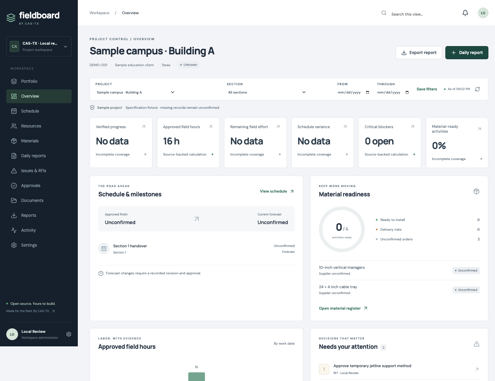

# Fieldboard

An open-source construction project dashboard by CAS-TX. Track schedules, crews, material readiness, issues and verified production in one self-hosted workspace. Every KPI includes its calculation, source IDs, versions, filters and timestamp.

**Status: functional beta, v0.1.0.** This is an independent application. Bidlark integration is a future phase; no Bidlark services, credentials or customer records are required.

[Project page](https://cas-tx.com/Dashboard) · [MIT license](LICENSE) · [Operating guide](docs/OPERATIONS.md) · [Architecture and integration](docs/ARCHITECTURE.md) · [Release scope](docs/RELEASE-SCOPE.md)



## Run locally

Requires Node.js 22 or newer and npm.

```sh
npm ci
npm run build
npm start
```

Open **http://127.0.0.1:4310**. Create your organization and administrator account. There is no default production password. Choose whether to load a clearly labeled sample project.

Local data persists in `.data/postgres/`, using PGlite's embedded PostgreSQL engine. Keep this directory between runs. Run one process per embedded database directory. For a hosted or multi-process installation, supply `DATABASE_URL` for PostgreSQL. Do not point the embedded directory at a network filesystem.

For development, use `npm run dev`. React changes hot-reload; restart the server after backend changes. `npm run preview` serves the built application locally.

## Working features

- Projects, section releases, portfolio sorting/search, favorites, archive/restore, working calendars and holiday exceptions.
- Activities, milestones and immutable schedule revisions with PM approval.
- Daily reports with field hours, separate PM hours, overtime, installed quantities, manual weather, safety notes and delays. Draft, submit, approve, reject, revise or void with an audit reason.
- Effort-weighted progress using each task's explicitly selected quantity, earned-standard-hours or manual percentage method. Hours spent never imply progress.
- Crew assignments, calendar capacity and potential cross-project crew overlaps within the user's permitted projects.
- Per-activity material requirements, allocated receipts, supplier references, unconfirmed delivery dates, holds and delivery risks.
- Issues, blockers, risks and RFIs with owners, severity, due dates and closure.
- Source drilldowns; historical project reconstruction; immutable PDF, Excel and JSON reports; daily labor chart data.
- Expiring, revocable, read-only publication snapshots with a strict external-data allowlist.
- PDF/JPEG/PNG attachments, signature checks, size limits and optional ClamAV integration. Unscanned files remain quarantined and cannot be downloaded.
- Server-enforced organization and project permissions, five roles, password hashing, session expiration, CSRF protection, rate limits, optimistic concurrency and transactional audit events.
- Project setup import/export and reusable templates that reset dates, releases, completion and receipts.
- Saved overview layouts, widget order, project favorites and filters; responsive layout and keyboard-operable controls.
- Automatic refresh every 30 seconds with a last-snapshot warning when refresh fails.

## A first real workflow

1. Create a project and its sections. Enter approved labor and calendar inputs.
2. Add field tasks and milestones. Set target quantities, units, effort weights and the progress method.
3. Add allocated material requirements and record confirmed GC release evidence.
4. Create a daily report for one task, then submit it. The dashboard excludes it until approval.
5. A PM approves the report with a reason. Open the field-hours or progress card to inspect the exact source records.
6. Generate an internal PDF/Excel report or publish a restricted customer snapshot. Revoke customer access whenever needed.

## Deploy on your infrastructure

See [OPERATIONS.md](docs/OPERATIONS.md) for HTTPS, PostgreSQL, initial setup, backups, recovery and attachment scanning. `Dockerfile` and `compose.yaml` provide a PostgreSQL deployment recipe. Deployment requires your own hostname, HTTPS reverse proxy, database password and random setup token. The application does not provision a domain, email account or cloud subscription.

The default install is one organization per workspace. All records are scoped by organization in server queries, with project assignments for field and purchasing users. The UI does not offer organization switching or self-service tenant signup.

## Validation

```sh
npm test
npm run build
npm audit
```

Tests exercise metric formulas, approval idempotency, version conflicts, tenant/project isolation, publication expiry and revocation, historical snapshots, actual PDF/Excel output, attachment quarantine, project import/templates and disk persistence. `npx tsx scripts/verify-exports.ts` generates synthetic reports for visual review under `.data/export-check/`.

See [RELEASE-SCOPE.md](docs/RELEASE-SCOPE.md) for implemented behavior, deployment verification limits and remaining enterprise work. This release does not claim SSO, billing, payroll, automatic scheduling, a live Bidlark connector or unattended email delivery.

## Open source

MIT licensed. Dependency licenses remain their own. Bundled font packages use the SIL Open Font License. No AI service, telemetry, paid API or external font request is required. Keep secrets, customer data, local fixture overrides, databases and exports out of source control.

Contributions are welcome. Include focused tests for metric or authorization changes, preserve source lineage, and never replace missing data with invented KPI values.
